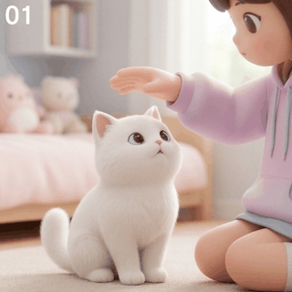

# banano2gif 🍌➡️🎞️

> **基于 AI 大模型九宫格连续序列帧的表情包与平滑无缝循环 GIF 动图生成引擎**  
> 默认内置官方 SDK，开箱即用。支持任意角色主体与动作，彻底去除数字角标，精准切帧，丝滑循环。

[](LICENSE)
[](https://www.python.org/)
[](https://hrioapi.hrio.site)

---

## 🌟 效果展示 (Demo Showcase)

| 1. AI 渲染九宫格原图 (1024x1024 纯净无角标) | 2. 自动高精度裁切后合成的丝滑无缝 GIF (180ms/帧) |
| :---: | :---: |
|  |  |

---

## 🔑 获取 API Key

本项目默认内置封装了轻量级原生 SDK，直连 **HrioAPI** 官方平台（支持 `gemini-nano-banana-2.1`、`gpt-image-2` 等最顶尖生图大模型）：

1. 前往官方网站注册登录：👉 **[https://hrioapi.hrio.site](https://hrioapi.hrio.site)**
2. 进入用户后台创建并复制您的专属 API Key (`sk-xxxxxxxx`)。
3. 配置环境变量或直接在命令行中传入：
   ```bash
   # Linux / macOS
   export HRIO_API_KEY="sk-xxxxxxxx"

   # Windows (CMD)
   set HRIO_API_KEY=sk-xxxxxxxx

   # Windows (PowerShell)
   $env:HRIO_API_KEY="sk-xxxxxxxx"
   ```

---

## ✨ 核心特性

- 🎯 **去数字序号机制（No 1~9 Numbers）**：
  - 彻底抛弃易诱导 AI 生成角标的 `1, 2, 3...` / `01, 02...` 编号写法；
  - 采用严密的**纯空间方位映射（Top-left, Middle-center, Bottom-right...）**与强制负向约束，生成 100% 干净无水印原画。
- 💃 **全场景通用动作生成（Beyond Just Cats）**：
  - 不仅支持可爱的女孩玩猫，更支持任意主体（人物、动物、机甲、二次元、像素风、3D盲盒）；
  - 内置常见动态表情包预设（挥手打招呼、哈哈大笑、委屈哭泣、眨眼比心、竖大拇指点赞等），并支持智能展开任意自定义连续动作。
- 📐 **工业级高精度定点裁切（Precision Slicing）**：
  - 实测剖析 1024×1024 图像的分割白线位置（X=341/682, Y=341/684），运用**中心对称定点裁切法（320×320）**；
  - 完美剔除所有分割白边，保证 9 帧画面中心同轴、零镜头抖动。
- 📦 **开箱即用，零繁琐依赖**：
  - 内置封装完整的 API Client，全工程除 `Pillow` 处理图片外无任何沉重第三方依赖。

---

## 🚀 快速上手

### 1. 安装依赖
```bash
git clone https://github.com/Mag1cFall/banano2gif.git
cd banano2gif
pip install -r requirements.txt
```

### 2. 命令行一键生成 (CLI)

```bash
# 查看所有支持的内置微动作预设
python main.py --list-presets

# 示例 1: 使用内置动作预设（挥手打招呼）
python main.py "可爱的3D柴犬戴着红色围巾" --preset waving --key "sk-xxxx"

# 示例 2: 生成摸摸头/玩猫猫表情包
python main.py "萌系Q版小女孩摸摸白猫的头" --preset petting --duration 180

# 示例 3: 完全自定义任意动作与风格
python main.py "赛博朋克机甲猫咪从胸口发射出一颗旋转爱心光波" --style "Cyberpunk neon anime style"
```

### 3. Python 代码集成

```python
from banano2gif import banano2gif

# 一键完成：构建提示词 -> 请求生图 -> 精准切帧 -> 合成 GIF
result = banano2gif(
    prompt="萌系Q版小女孩温柔抚摸白猫的头",
    preset="petting",       # 可选内置微动作预设
    duration_ms=180,        # 每帧播放毫秒数（推荐 160~200ms）
    api_key="sk-xxxx",      # 未传则自动读取环境变量 HRIO_API_KEY
    output_dir="output",
)

print("🎉 GIF 制作成功:", result["gif_path"])
print("📁 9张无缝序列帧保存在:", result["frames_dir"])
```

---

## 📚 内置常用微动作预设列表

| 预设代码 (`--preset`) | 动作名称 | 动作循环逻辑与幅度 |
| :--- | :--- | :--- |
| `waving` | **挥手打招呼** | 手臂从胸前抬起 -> 掌心向前左右摆动 15° -> 欢快微笑 -> 降回胸前闭环循环 |
| `petting` | **温柔抚摸宠物** | 手掌凌空逼近 -> 掌心触碰额头 -> 顺滑抚摸至后颈/背部 -> 猫咪眯眼仰头享受 -> 手抬起归位闭环 |
| `laughing` | **哈哈大笑/欢脱** | 微笑挑眉 -> 仰头放声大笑 -> 肩膀微微颤动欢脱 -> 缓和回笑闭环 |
| `crying` | **委屈哭泣/泪目** | 憋嘴泛泪 -> 泪珠滑落 -> 爆出动漫瀑布泪花 -> 抽泣擦泪闭环 |
| `heart_wink` | **眨眼比心** | 灿烂微笑 -> 右眼眨眼 Wink -> 手指搓出爱心光波飘起 -> 归位闭环 |
| `thumbs_up` | **竖大拇指点赞** | 握拳抬臂 -> 伸出大拇指向前挺进点赞 -> 闪烁星芒好评 -> 缓缓收回闭环 |

---

## 🛠️ 目录架构说明

```
banano2gif/
  ├── banano2gif/
  │     ├── __init__.py          # 模块导出接口
  │     ├── core.py              # 主调度逻辑（生图、切帧、GIF合成）
  │     ├── sdk/                 # 内置 HrioAPI 客户端封装 (无需安装外部包)
  │     │     ├── __init__.py
  │     │     └── client.py
  │     ├── prompts/             # 提示词工程引擎（去序号、锁机位、微动模板）
  │     │     ├── __init__.py
  │     │     └── engine.py
  │     └── cutter/              # 图像裁切与动图合成
  │           ├── __init__.py
  │           ├── slicer.py      # 九宫格高精度定点裁切器 (剔除分割线)
  │           └── gif_builder.py # 平滑无限循环 GIF 打包器
  ├── examples/                  # 官方实测示例效果图与动图
  ├── main.py                    # 命令行入口脚本
  ├── setup.py                   # 安装配置文件
  ├── requirements.txt           # 基础运行依赖 (Pillow)
  └── README.md                  # 中英文使用与开发文档
```

---

## 📄 开源许可证

本项目基于 [MIT License](LICENSE) 开源协议。欢迎提交 PR 与 Issue！
